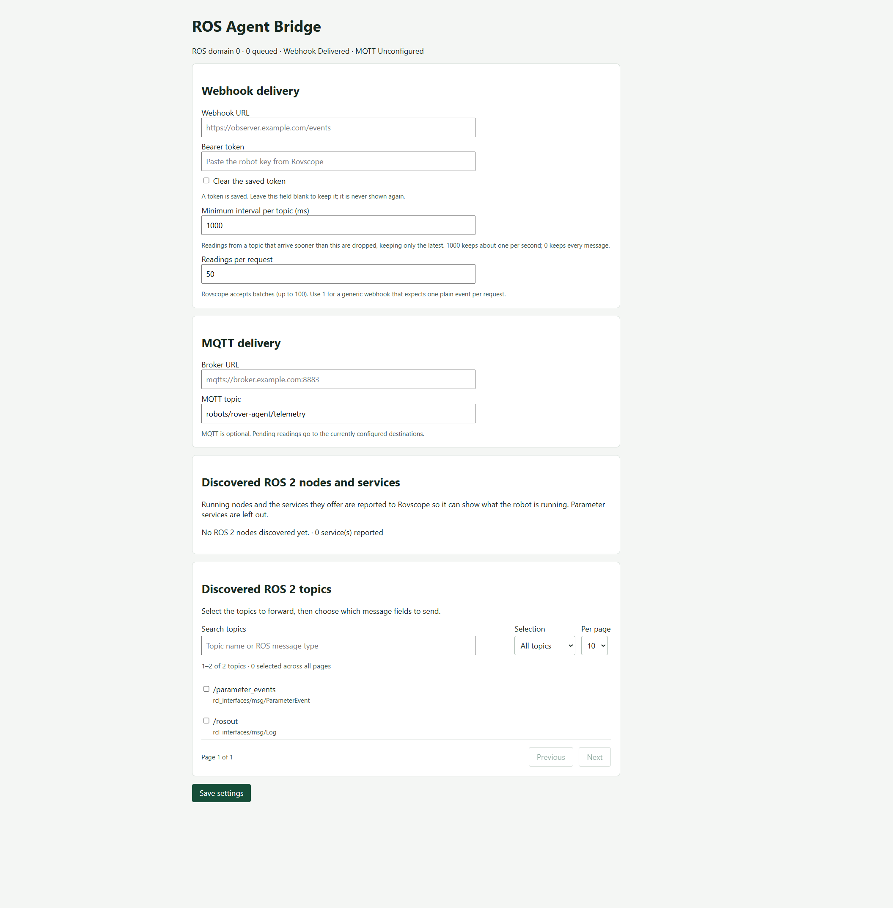

# RoboRelay

**RoboRelay forwards your ROS 2 robot's telemetry to any HTTP webhook or MQTT broker, and never loses a reading.**

Pick the topics you care about in a local web page, point RoboRelay at a webhook or an MQTT broker, and
it forwards them. If the network drops, nothing is lost: every reading waits in a disk queue and is
delivered when the link returns.

- **Zero-code setup**: auto-discovers topics, nodes and services; choose what to send with a click.
- **Reliable by design**: disk-backed queue with retry, so readings survive outages and restarts.
- **Flexible destinations**: any HTTP webhook, any MQTT broker, or both at once.
- **Easy to deploy**: one `.deb` installer that runs as a systemd service, with Node.js bundled.
- **Lightweight**: a small Node.js agent that runs right next to the robot.



Released under the [MIT License](LICENSE).

## What it is

RoboRelay is a small Node.js agent that runs next to a ROS 2 robot. It discovers the robot's topics, nodes and
services, forwards the topics you select to an **HTTP webhook** and/or an **MQTT** broker, and
keeps every reading in a disk queue until it is delivered. A local web page at
http://localhost:8780 is used to choose topics and destinations.

- Target: **Ubuntu 26.04** with **ROS 2 Lyrical** (a native machine, a robot computer, or Ubuntu in WSL 2).
- Version: see `package.json` (this branch: 0.1.6).

There are two ways to run it:

| | When to use | Needs on the machine |
|---|---|---|
| **A. Installer (`.deb`)** | A robot or a PC that should run the bridge as a service | ROS 2 Lyrical only (Node.js is bundled) |
| **B. From source** | Development, or trying it out | ROS 2 Lyrical and Node.js 24 |

---

## 1. Prerequisites

1. **Ubuntu 26.04.** On Windows, install it under WSL 2 (`wsl --install -d Ubuntu-26.04`), enable
   systemd in `/etc/wsl.conf` (`[boot]` then `systemd=true`), and run `wsl --shutdown` once.
2. **ROS 2 Lyrical** (`ros-lyrical-ros-base` or desktop) from the ROS apt repository. Check it:
   ```bash
   source /opt/ros/lyrical/setup.bash
   ros2 topic list
   ```
3. **Only for option B, and for building the installer:** Node.js 24 with npm, for example through nvm:
   ```bash
   curl -o- https://raw.githubusercontent.com/nvm-sh/nvm/v0.40.3/install.sh | bash
   source ~/.nvm/nvm.sh && nvm install 24
   ```
4. **The robot (or simulator) on the same ROS domain.** The bridge uses `ROS_DOMAIN_ID` (default `0`),
   which must match the robot. In WSL, discovering robots on the LAN depends on WSL networking
   (mirrored mode works best); a simulator inside the same WSL distro always works.

## 2. Prepare a destination

RoboRelay needs at least one place to send readings:

1. **An HTTP webhook** that accepts `POST` with a JSON body, and optionally a bearer token for it.
   By default readings are sent in batches as `{"events": [...]}`; see
   [Settings](#5-settings-on-the-bridge-page) to send one plain event per request instead.
2. **And/or an MQTT 5 broker** (for example Mosquitto, EMQX or HiveMQ) and a topic to publish to.

If the destination runs on the Windows PC and RoboRelay runs in WSL, use `http://localhost:<port>/...`
with WSL mirrored networking, otherwise use the Windows host IP (inside WSL:
`ip route show default | awk '{print $3}'`).

Use a separate token per robot where your destination supports it.

## 3A. Install with the `.deb` installer (recommended for robots)

**Build the installer** once, on any Ubuntu 26.04 machine with ROS 2 Lyrical, Node.js 24 and internet:

```bash
cd roborelay
bash packaging/build-deb.sh
# -> dist/roborelay_<version>-1_amd64.deb
```

The package is built for the CPU architecture of the build machine (amd64 here). Build on an arm64
machine for an arm64 robot.

**Install it** on the robot computer (copy the `.deb` there first):

```bash
sudo apt install ./roborelay_0.1.6-1_amd64.deb
sudo systemctl status roborelay --no-pager
```

The service starts immediately and on every boot. Stop any other bridge using port 8780 first.

**Configure it** (optional). The installer creates `/etc/roborelay/agent.env`:

```bash
sudo nano /etc/roborelay/agent.env    # ROS_DOMAIN_ID, PORT, ROS_OVERLAY, credentials
sudo systemctl restart roborelay
```

Set `ROS_OVERLAY=/path/to/your_ws/install/setup.bash` if the robot uses custom message packages.

**Everyday commands:**

```bash
sudo journalctl -u roborelay -f      # logs
sudo systemctl restart roborelay
sudo systemctl stop roborelay
sudo apt remove roborelay            # uninstall (queued data is kept)
```

Program files live in `/opt/roborelay`. Settings and the queue live in
`/var/lib/roborelay/data`, and upgrades keep them. More detail: [packaging/README.md](packaging/README.md).

## 3B. Run from source

```bash
cd roborelay
cp .env.example .env      # optional: MQTT credentials, WEBHOOK_TOKEN, PORT, AGENT_ID
bash run.sh --install     # once: npm ci with ROS sourced (builds the ROS bindings)
bash run.sh               # start; Ctrl+C to stop
```

`run.sh` sources `/opt/ros/lyrical/setup.bash` (override with `ROS_SETUP=...`) and loads nvm when `node`
is not on the PATH. If you add custom ROS message packages later, source their workspace and run
`bash run.sh --install` again so their bindings are generated. Settings and the queue are kept in
`./data`. Run only one bridge per `data` directory.

## 4. Configure destinations

1. Open **http://localhost:8780** on the robot computer (or in Windows, for WSL).
2. **Webhook URL**: your endpoint from step 2. **Bearer token**: optional, sent as an `Authorization` header.
3. In **Discovered ROS 2 topics**, tick the topics to forward (for example `/odom`, `/battery_state`,
   `/joint_states`, `/fix`). Search and the filters help with long lists.
4. Click **Save settings**.
5. RoboRelay also sends a snapshot of the robot's nodes, services and topics every minute (as a
   `roborelay/NodeList` event), even with no topic selected, which doubles as a heartbeat.

When it works, the status line on the bridge page shows **Webhook Delivered** and **0 queued**.

## 5. Settings on the bridge page

- **Minimum interval per topic** (default 1000 ms): keeps only the newest reading per topic in each
  interval. 0 forwards every message.
- **Readings per request** (default 50): readings sent together as `{"events": [...]}`. Set 1 to send
  one plain event per request with an `Idempotency-Key` header (for generic webhooks).
- **Payload**: under each selected topic, choose which message fields are sent. **Bridge metadata**
  chooses which of `id`, `agentId`, `topic`, `type` and `receivedAt` are sent.
- **Broker URL / MQTT topic** (optional): an MQTT 5 broker, `mqtts://host:8883` for a remote broker or
  `mqtt://localhost:1883` locally. Credentials go in `.env` (source) or `agent.env` (installer) as
  `MQTT_USERNAME` and `MQTT_PASSWORD`. Leave blank for webhook only.

QoS: a subscription is reliable when every publisher is reliable; otherwise it uses the sensor-data
profile, so best-effort publishers (most sensors) still connect.

## 6. Delivery and the queue

Every reading is written to `data/outbox` before it is sent. If the webhook or broker is down, readings
stay queued and are sent in order when it is back, including after a restart. A file is removed only
when every configured destination has acknowledged it. With no destination set, readings accumulate, so
watch disk space during long outages. Consumers should ignore repeats by event `id`: after a retry or restart the same reading can arrive more than once.

## 7. Try it without a robot

```bash
source /opt/ros/lyrical/setup.bash
ros2 topic pub -r 1 /chatter std_msgs/msg/String "{data: hello}"
```

Select `/chatter std_msgs/msg/String` on the bridge page and save. For a local MQTT test broker (needs
Docker): `docker compose up -d mqtt`, then use broker URL `mqtt://localhost:18884`.

## 8. Troubleshooting

| Symptom | Check |
|---|---|
| No topics listed | Same `ROS_DOMAIN_ID` as the robot? Does `ros2 topic list` show them in a sourced shell? |
| A topic is listed but nothing arrives | Is it publishing (`ros2 topic hz <topic>`)? Errors are shown on the bridge page. |
| `HTTP 401` from the webhook | Wrong or revoked robot key; check the bearer token. |
| `fetch failed` from the webhook | The destination is not reachable from this machine (try `curl <url>`; WSL: see step 2). |
| A custom message type fails | Source its workspace (`ROS_OVERLAY`), then reinstall dependencies or rebuild the `.deb`. |
| Port 8780 in use | Another bridge is running; stop it or set `PORT`. |

## Repository layout

```
src/          agent (index.js), delivery, disk queue, message field discovery
public/       local web page
docs/         screenshots
packaging/    .deb build script, systemd service, agent.env template
run.sh        run from source
compose.yaml  optional: the bridge in Docker and a local Mosquitto broker
```
